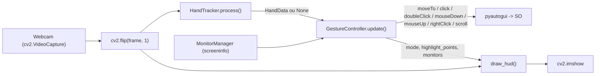

# Arquitetura do Virtual Gesture Mouse

Detalhamento do fluxo, das equações de mapeamento/interpolação, do suporte a múltiplos monitores e da máquina de estados.
Visão geral resumida em [ARCHITECTURE.md](ARCHITECTURE.md). Guia prático em [features_multimonitor_duplo_clique.md](features_multimonitor_duplo_clique.md).

## 1. Fluxo de dados (por quadro)



1. `main.py` lê o frame e o espelha horizontalmente (mover a mão para a direita move o cursor para a direita).
2. `HandTracker` converte o frame para RGB, roda o MediaPipe e devolve um `HandData` com os 21 landmarks **em pixels do frame**.
3. `GestureController` classifica o gesto, atualiza a máquina de estados, mapeia coordenadas no `MonitorManager` e executa as ações no SO.
4. `main.py` desenha o HUD (com status de monitor ativo e feedbacks) e trata atalhos (`ESC`/`q` para sair, tecla de troca de tela). Ao sair, `controller.shutdown()` garante `mouseUp()`.

## 2. Mapeamento de Coordenadas e Múltiplos Monitores

Seja `(fw, fh)` o tamanho do frame capturado da câmera e `m_x`/`m_y` as margens configuradas (`FRAME_MARGIN_X/Y`).
A posição da ponta do indicador (landmark 8) `(x, y)` dentro da moldura ativa é primeiramente normalizada para o intervalo unitário `[0.0, 1.0]`:

```
u = clamp( (x - m_x) / (fw - 2·m_x), 0.0, 1.0 )
v = clamp( (y - m_y) / (fh - 2·m_y), 0.0, 1.0 )
```

Essa normalização cria uma *deadzone* nas bordas da câmera: os 4 cantos da moldura ativa correspondem aos extremos do espaço de exibição.

### 2.1 Virtual Desktop Bounding Box (Modo `SPAN`)
No modo `SPAN`, o cursor percorre dinamicamente a área combinada de todos os monitores conectados.
O `MonitorManager` descobre as telas via `screeninfo` e calcula a caixa delimitadora (*bounding box*) do desktop virtual:

```
x_min = min(m.x para todo monitor m)
y_min = min(m.y para todo monitor m)
x_max = max(m.x + m.width para todo monitor m)
y_max = max(m.y + m.height para todo monitor m)

Largura_Virtual = x_max - x_min
Altura_Virtual  = y_max - y_min
```

O mapeamento linear para as coordenadas globais do SO é:

```
X_alvo = x_min + u · (Largura_Virtual - 1)
Y_alvo = y_min + v · (Altura_Virtual - 1)
```

**Clamp para geometrias não retangulares:** Como monitores podem ter resoluções ou orientações diferentes (ex.: monitor secundário deslocado verticalmente), se `(X_alvo, Y_alvo)` cair em uma "zona morta" fora de qualquer tela física, o ponto é projetado (*clamped*) para o monitor mais próximo, evitando que o cursor fique invisível ou inacessível.

### 2.2 Modo Monitor Ativo (`ACTIVE_SWITCH`)
No modo `ACTIVE_SWITCH`, a moldura ativa da webcam é mapeada exclusivamente para o monitor atualmente ativo `M_ativo` (com sensibilidade 1:1 e máxima precisão):

```
X_alvo = M_ativo.x + u · (M_ativo.width - 1)
Y_alvo = M_ativo.y + v · (M_ativo.height - 1)
```

A troca de tela pode ser disparada pela tecla de atalho (`MONITOR_SWITCH_KEY`, padrão `'m'`) ou pelas teclas `'1'` a `'9'`. Ao alternar, o cursor é suavemente reposicionado no centro do novo monitor.

## 3. Suavização anti-jitter (LERP / EMA)

Com `α = SMOOTHING_FACTOR ∈ (0, 1]`, `P_t` a posição suavizada e `T_t` o alvo mapeado:

```
P_t = P_(t-1) + (T_t - P_(t-1)) · α
```

É uma média móvel exponencial: o peso da amostra mais recente é `α` e o da história `1-α`.
Atraso aproximado (constante de tempo) ≈ `(1-α)/α` quadros (ex.: α=0,25 ⇒ ~3 quadros ≈ 100 ms a 30 FPS).

- Deadzone: se `‖T_t - P_(t-1)‖ < MIN_MOVE_PIXELS`, o cursor não se move (elimina tremor com a mão parada).
- Ao alternar monitor ou pausar, o cursor é ancorado na posição real atual (`pyautogui.position()`), evitando saltos indesejados.

## 4. Máquina de Estados dos Gestos

A máquina de estados foi expandida para acomodar o clique simples, arraste confiável, clique direito e as **duas modalidades de Duplo Clique**:

| Modo (`Mode`) | Condição | Ação |
|---|---|---|
| `IDLE` | Nenhuma mão (após `LOST_HAND_TOLERANCE_FRAMES`) | Libera arraste se pendente (`mouseUp`) |
| `PAUSED` | Mão visível sem gesto válido (punho, palma aberta) | Cursor em repouso |
| `NAVIGATING` | Só o indicador esticado | `moveTo` suavizado |
| `CLICK` | Pinça polegar(4)–indicador(8) recém-fechada (< `DRAG_HOLD_TIME`) | Cursor temporariamente ancorado; aguarda confirmação |
| `DRAGGING` | Pinça polegar(4)–indicador(8) mantida por `≥ DRAG_HOLD_TIME` | `mouseDown()` mantido; cursor arrasta janelas/arquivos; `mouseUp()` ao abrir |
| `RIGHT_CLICK` | Pinça polegar(4)–médio(12) fechada | `rightClick()` (com trava de 1 disparo e debounce) |
| `DOUBLE_CLICK` | **A)** 2 toques da pinça padrão em `< DOUBLE_CLICK_TIMEOUT`<br>**B)** Pinça polegar(4)–anelar(16) | `doubleClick()` disparado imediatamente; prevenção de conflito: **nunca** prende em `is_dragging` |
| `SCROLL` | Indicador e médio esticados, anelar e mínimo recolhidos | `scroll()` proporcional ao deslocamento vertical |

### 4.1 Diagrama de Estados

```mermaid
stateDiagram-v2
    [*] --> IDLE
    IDLE --> PAUSED: mão detectada
    PAUSED --> NAVIGATING: só indicador esticado
    NAVIGATING --> SCROLL: indicador + médio esticados
    SCROLL --> NAVIGATING: só indicador esticado

    NAVIGATING --> CLICK: pinça indicador fecha
    CLICK --> DRAGGING: mantido por >= DRAG_HOLD_TIME (mouseDown)
    DRAGGING --> NAVIGATING: pinça indicador abre (mouseUp)

    CLICK --> PENDING_TAP: pinça abre em < DRAG_HOLD_TIME
    PENDING_TAP --> DOUBLE_CLICK: 2ª pinça fecha em < DOUBLE_CLICK_TIMEOUT
    PENDING_TAP --> NAVIGATING: timeout expira (dispara click simples)

    NAVIGATING --> RIGHT_CLICK: pinça médio fecha (d < close)
    RIGHT_CLICK --> NAVIGATING: pinça médio abre (d > open)

    NAVIGATING --> DOUBLE_CLICK: pinça anelar fecha (d(4,16) < close)
    DOUBLE_CLICK --> NAVIGATING: pinça anelar abre (d(4,16) > open)

    DRAGGING --> IDLE: mão perdida (mouseUp)
    NAVIGATING --> IDLE: mão perdida
```

### 4.2 Lógica do Duplo Clique e Prevenção de Conflito

1. **Detecção Temporal (Double-Tap do Indicador):**
   - Ao fechar a pinça, o controlador congela o cursor no ponto âncora e inicia um temporizador.
   - Se o usuário soltar a pinça em menos de `DRAG_HOLD_TIME` (ex.: 180ms), entende-se como um toque rápido (*tap*). O clique ainda não é enviado.
   - Se uma segunda pinça ocorrer antes de `DOUBLE_CLICK_TIMEOUT` (ex.: 350ms), a intenção de duplo clique é confirmada: dispara `pyautogui.doubleClick()` e marca a fase como `CONSUMED`.
   - Se o tempo expirar sem uma segunda pinça, o controlador executa `pyautogui.click()` retroativo exatamente nas coordenadas da âncora original.
2. **Gesto Dedicado Instantâneo (Pinça Anelar + Polegar):**
   - Distância euclidiana entre Landmark 16 (ponta do anelar) e Landmark 4 (ponta do polegar).
   - Se `d(4, 16) < RING_PINCH_THRESHOLD`, executa imediatamente `pyautogui.doubleClick()`.
   - Inclui debounce (`DOUBLE_CLICK_DEBOUNCE_S`) e trava de gesto (exige reabertura da pinça antes do próximo disparo).
   - **Prevenção de Falso Positivo:** Se a mão estiver em punho fechado (indicador, médio e mínimo recolhidos), a pinça do anelar é ignorada (`RING_PINCH_REQUIRE_OPEN_HAND = True`), permitindo fechar a mão para pausar sem disparar duplo clique.
   - **Prevenção de Conflito com Arraste:** O duplo clique nunca altera a flag `is_dragging` nem aciona `mouseDown()`, impedindo que janelas fiquem presas ao cursor.

### 4.3 Distância de Pinça Normalizada e Histerese
A distância entre dedos é normalizada pelo tamanho da mão:

```
d_norm = ‖L_a - L_b‖ / ‖L_0 - L_9‖        (L_0 = punho, L_9 = base do dedo médio)
```

- Fecha a pinça quando `d_norm < PINCH_CLOSE_THRESHOLD_NORM` (0,28).
- Reabre apenas quando `d_norm > PINCH_OPEN_THRESHOLD_NORM` (0,40).
- A histerese elimina vibrações de sinal nas proximidades do limiar.
